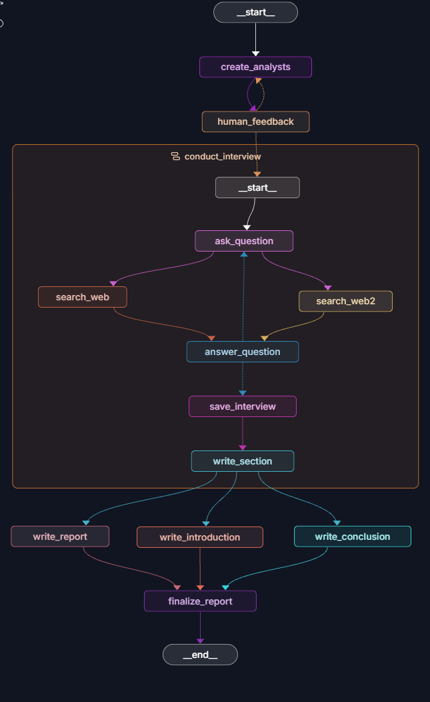
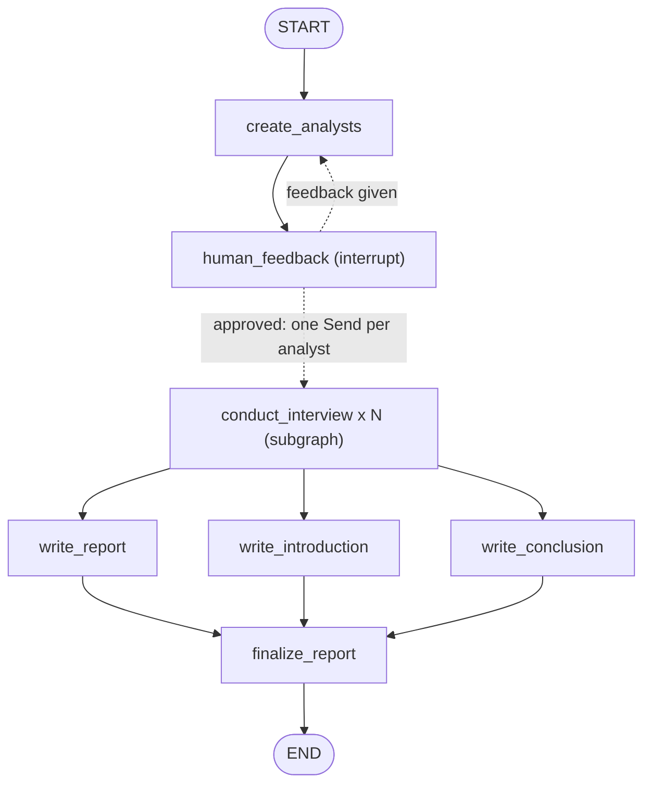
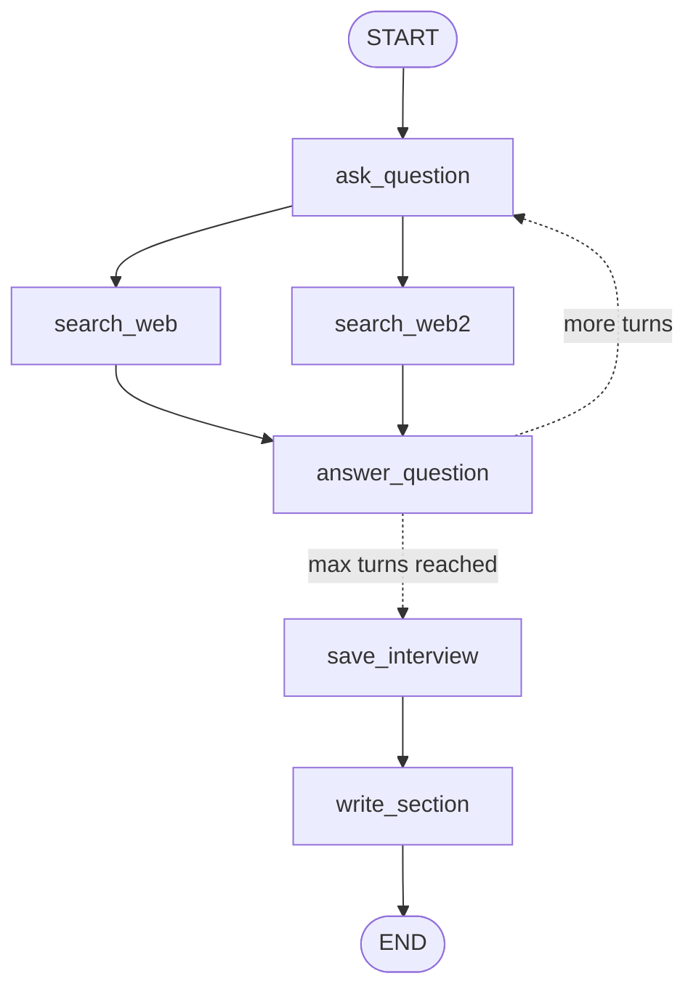

# LangGraph Research Assistant

> A multi-agent research workflow that creates analyst personas, runs parallel interview loops with web search, and synthesizes the results into a cited report using LangGraph, LangChain, Groq, and Tavily.

[](https://www.python.org/)
[](https://www.langchain.com/langgraph)
[](https://www.langchain.com/)
[](https://groq.com/)
[](https://www.tavily.com/)
[](https://docs.astral.sh/uv/)

---

## What Is This?

This project is a LangGraph-powered research assistant inspired by analyst interview workflows. Given a research topic, the system generates a panel of analyst personas, gives the user a chance to approve or revise them, sends each analyst through an interview loop, gathers web context with Tavily, and combines the resulting memos into a final Markdown report.

The project demonstrates several practical agent patterns:

- Human-in-the-loop review before the research process begins (LangGraph `interrupt`).
- Structured analyst generation with Pydantic models.
- Parallel interview fan-out using LangGraph's `Send` API.
- A reusable interview subgraph embedded as a node in the main graph.
- Search-grounded question answering with Tavily.
- Map-reduce style report writing across analyst sections.
- LangGraph graph configuration for local development and Studio inspection.

| File | Responsibility |
|---|---|
| `src/agent.py` | **Main graph** (`research_agent`): analysts, human review, parallel interviews, and final report |
| `src/creating_analysts.py` | Small graph (`create_analysts`): analyst generation with a human feedback interrupt |
| `src/answering_question.py` | Interview subgraph (`question_answer_graph`): question, search, answer, and section writing |
| `src/utils/nodes.py` | Node implementations for analysts, interviews, search, and report writing |
| `src/utils/edges.py` | Conditional routing logic and the interview fan-out (`Send`) |
| `src/utils/states.py` | `TypedDict` and `MessagesState` definitions used by the graphs |
| `src/utils/objects.py` | Pydantic models for analyst personas and structured outputs |
| `src/utils/prompts.py` | Prompt templates for analyst creation, interviews, search, and report synthesis |
| `src/utils/models.py` | Groq chat model initialization |
| `src/utils/tools.py` | Empty placeholder for future LLM tools |
| `main.py` | Placeholder entry point (the real workflow runs through LangGraph) |
| `langgraph.json` | LangGraph CLI/Studio graph registration |
| `notes.md` | Study notes on every concept used in this project |

---

## Graph Diagrams

### LangGraph Studio View



The `research_agent` graph as rendered by LangGraph Studio, with the `conduct_interview` subgraph expanded. The two diagrams below show the same structure in text form (dotted lines are conditional edges).

### Full Research Graph (`research_agent`)



### Interview Subgraph (`question_answer_graph`)



You can also see the live graph, step by step, in LangGraph Studio (see [Getting Started](#getting-started)).

---

## Feature List

### Analyst Generation

- Generates a configurable number of analyst personas for a research topic.
- Uses structured output through the `Perspectives` and `Analyst` Pydantic models.
- Captures analyst name, role, affiliation, and description; a derived `persona` text is built from them for prompts.
- Supports human review through a LangGraph interrupt before continuing.

### Interview Workflow

- Each analyst starts with a topic-aware opening line and then asks questions in character.
- The expert answer is grounded in retrieved context, with `[1]`, `[2]` style source references.
- The interview loop continues until the expert has answered the maximum number of turns (default: 2).
- Finished interviews are saved as transcripts and converted into short report sections.

### Web Research

- Tavily search is used to retrieve external context for analyst questions.
- Search queries are generated by the LLM from the conversation state rather than hard-coded.
- Retrieved documents are formatted with source URLs for downstream citation.

### Report Synthesis

- Analyst sections are gathered into a consolidated report body.
- Introduction, body, and conclusion are generated as separate, parallel graph nodes.
- Final output is assembled into a Markdown report with preserved citations and a sources list.

---

## How It Works

1. **The user provides a topic.** The graph receives a research topic and a maximum number of analysts.

2. **Analyst personas are generated.** `create_analysts` uses the Groq-hosted model with structured output to create distinct expert perspectives.

3. **Human feedback is requested.** The `human_feedback` node calls LangGraph's `interrupt()` and pauses the run. The user either approves the analysts (empty reply, `yes`, `okay`, `perfect`, or `continue`) or replies with feedback, which sends the graph back to `create_analysts`.

4. **Interviews run in parallel.** When approved, `initiate_all_interviews` fans out one interview subgraph per analyst using `Send`.

5. **Each interview searches the web.** The interview graph generates a search query from the current conversation and retrieves context through Tavily (two search nodes run in parallel).

6. **Expert answers are generated.** The model answers using only the retrieved context and includes source references. The analyst and expert alternate until the turn limit is reached.

7. **Sections are written.** Each completed interview becomes a concise report section, and all sections are merged into one list by a reducer.

8. **The final report is assembled.** The report body, introduction, and conclusion are written in parallel, and `finalize_report` stitches them (plus the sources) into the final Markdown output.

---

## Architecture

```text
Research topic
    -> create_analysts
        -> Analyst personas
    -> human_feedback            (interrupt: waits for the user)
        -> regenerate analysts when feedback is provided
        -> continue when approved
    -> conduct_interview for each analyst   (parallel, via Send)
        -> ask_question
        -> search_web  + search_web2        (parallel)
        -> answer_question
        -> repeat until max turns
        -> save_interview
        -> write_section
    -> write_report + write_introduction + write_conclusion   (parallel)
    -> finalize_report
    -> final Markdown report
```

Registered graphs in `langgraph.json`:

| Graph | Entry Point | Purpose |
|---|---|---|
| `create_analysts` | `src/creating_analysts.py:graph` | Generate and review analyst personas |
| `question_answer_graph` | `src/answering_question.py:question_answer_graph` | Run a single interview workflow |
| `research_agent` | `src/agent.py:graph` | Run the complete research and reporting workflow |

---

## Project Structure

```text
LangGraph_Research_Agent/
|
+-- main.py
+-- langgraph.json
+-- pyproject.toml
+-- uv.lock
+-- .python-version
+-- README.md
+-- notes.md
+-- src/
|   +-- __init__.py
|   +-- agent.py
|   +-- answering_question.py
|   +-- creating_analysts.py
|   `-- utils/
|       +-- __init__.py
|       +-- edges.py
|       +-- models.py
|       +-- nodes.py
|       +-- objects.py
|       +-- prompts.py
|       +-- states.py
|       `-- tools.py
`-- .env                (local only, not committed)
```

---

## Getting Started

### Prerequisites

| Requirement | Notes |
|---|---|
| Python 3.14+ | Required by `pyproject.toml` (`.python-version` pins 3.14) |
| `uv` | Used for dependency installation and command execution |
| Groq API key | Required for `ChatGroq` |
| Tavily API key | Required for web search |

Check your local versions:

```bash
python --version
uv --version
```

If `uv` is not installed:

```bash
pip install uv
```

### 1. Clone the repository

```bash
git clone https://github.com/rajat-relkar/LangGraph-Research-Assistant-Agent.git
cd LangGraph-Research-Assistant-Agent
```

### 2. Install dependencies

```bash
uv sync
```

This creates the virtual environment and installs the locked dependencies from `uv.lock`.

### 3. Configure environment variables

Create a `.env` file in the project root:

```env
GROQ_API_KEY=your_groq_api_key_here
TAVILY_API_KEY=your_tavily_api_key_here
```

Keep `.env` local and do not commit real API keys.

### 4. Run with LangGraph

Start the LangGraph development server:

```bash
uv run langgraph dev
```

Then open the local LangGraph Studio URL shown in your terminal. The configured graphs (`create_analysts`, `question_answer_graph`, `research_agent`) are loaded from `langgraph.json`.

When a run reaches `human_feedback`, Studio pauses and shows the generated analysts. Resume the run with either feedback text (to regenerate) or an approval word to continue.

---

## Example Inputs

### Analyst Generation

Use the `create_analysts` graph with state like:

```json
{
  "topic": "How autonomous AI agents are changing software engineering teams",
  "max_analysts": 3
}
```

### Full Research Report

Use the `research_agent` graph with state like:

```json
{
  "topic": "The business impact of retrieval-augmented generation in enterprise support teams",
  "max_analysts": 3
}
```

The full graph returns a `final_report` field containing the generated Markdown report.

---

## Environment Variables

| Variable | Required | Purpose |
|---|---:|---|
| `GROQ_API_KEY` | Yes | Authenticates the Groq chat model used by LangChain (`ChatGroq`) |
| `TAVILY_API_KEY` | Yes | Authenticates Tavily web search |

---

## Key Design Decisions

| Choice | Reason |
|---|---|
| LangGraph state machines | Makes the agent workflow explicit, inspectable, and easier to debug |
| Human feedback interrupt | Allows analyst personas to be reviewed before expensive research begins |
| Structured analyst objects | Keeps persona generation predictable and type-safe |
| Interview subgraph | Encapsulates repeated question, search, answer, and section-writing behavior |
| Parallel fan-out (`Send`) | Lets each analyst pursue their own research direction independently, with a number of branches decided at runtime |
| Reducers (`operator.add`) | Let parallel branches append to the same list (`context`, `sections`) without overwriting each other |
| Separate report nodes | Keeps introduction, body, conclusion, and final assembly easy to iterate on |
| Prompts in one file | All wording lives in `prompts.py`, so behavior can be tuned without touching graph logic |
| `temperature=0` | Keeps structured output and factual answers as repeatable as possible |

---

## Tech Stack

| Layer | Tool | Role |
|---|---|---|
| Language | Python 3.14+ | Application runtime |
| Graph orchestration | LangGraph | Stateful graph execution, interrupts, and fan-out |
| LLM framework | LangChain | Message handling, structured output, and model integration |
| LLM provider | Groq (`openai/gpt-oss-120b`) | Analyst generation, interview responses, and report writing |
| Web research | Tavily | Search API for retrieval-grounded answers |
| Data models | Pydantic | Structured LLM output and validation |
| Configuration | python-dotenv | Loads local environment variables from `.env` |
| Package management | uv | Dependency resolution and command execution |

---

## Limitations

- The project requires valid Groq and Tavily API keys.
- Report quality depends on the specificity of the topic and the quality of Tavily search results.
- Generated reports should be reviewed before being used for business, academic, legal, medical, or financial decisions.
- The current `main.py` is a minimal placeholder; the primary workflow is exposed through LangGraph.
- The interview graph currently includes two near-identical search nodes, `search_web` and `search_web2`, so a turn makes two similar searches.
- Interview length is controlled only by a turn counter (default 2); the analyst's "Thank you so much for your help!" closing line is not detected.
- See the "Known issues" section of [notes.md](notes.md) for the bugs already fixed and the remaining code-level gotchas.

---

## Future Improvements

- Add a polished CLI runner for invoking the full research graph from the terminal.
- Add automated tests for graph routing, structured output parsing, and report assembly.
- Add configurable model selection through environment variables.
- Deduplicate the two Tavily search node implementations (or give the second one a different source).
- Remove unused dependencies (`colorama`, `langchain-community`, `langchain-openai`) or put them to use.
- Persist reports to Markdown files or a lightweight database.
- Add richer source handling with normalized citations and source metadata.
- Add a Streamlit or FastAPI interface for non-technical users.

---

## Learning Notes

[notes.md](notes.md) explains every concept used in this project (LangGraph, LangChain, Pydantic, Tavily, uv, and more), walks through a full run, and includes interview-style questions with answers.

---

## Security Notes

- Never commit `.env` or real API keys.
- Rotate keys immediately if they are accidentally pushed to a public repository.
- `.langgraph_api/` holds local dev-server state created by `langgraph dev`; keep it out of version control.
- Treat generated reports as research drafts, not final professional advice.

---

