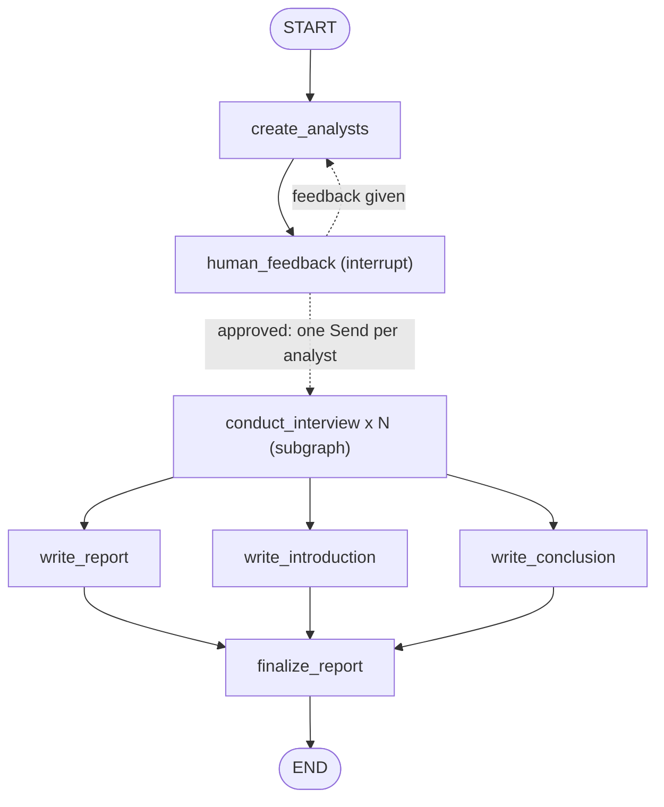
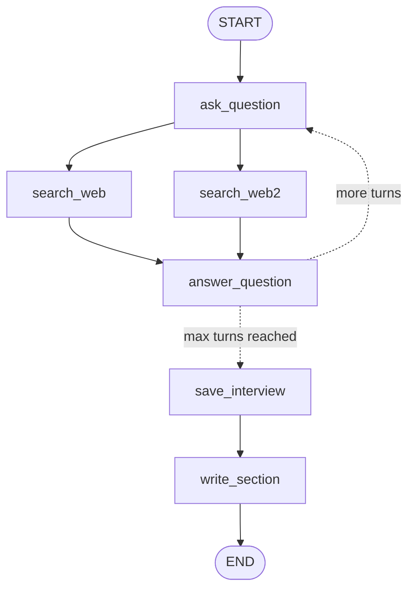

# Project Notes: LangGraph Research Assistant

> **Purpose:** a study guide for this project (you). Read it to remember *how the project works*, to understand *every concept it uses*.
>
> **How to use it**
> 1. Read sections 1-3 to get the big picture and follow one full run.
> 2. Read sections 4-8 as reference material (LangGraph, LangChain, AI, Python, tooling). Each concept has *what it is*, *where it is in this project*, and a one-line *interview answer*.
> 3. Read section 11 ("Known issues") so you can talk honestly about the limits of the code, including the three bugs that were found and fixed.
>
> **Version snapshot** (from `uv.lock` / the installed `.venv`): Python 3.14, `langgraph` 1.2.17, `langchain` 1.4.7, `langchain-core` 1.7.0, `langchain-groq` 1.1.3, `langchain-tavily` 0.2.18, `pydantic` 2.14.1, `langgraph-cli` 0.4.38. APIs below are described for these versions.
>
> Facts marked **(verified)** were checked by actually running the code in this repo.

---

## Table of contents

1. [The project in 60 seconds](#1-the-project-in-60-seconds)
2. [Architecture](#2-architecture)
3. [One full run, step by step](#3-one-full-run-step-by-step)
4. [LangGraph concepts](#4-langgraph-concepts)
5. [LangChain concepts](#5-langchain-concepts)
6. [LLM and AI-engineering concepts](#6-llm-and-ai-engineering-concepts)
7. [Python concepts used](#7-python-concepts-used)
8. [Tooling and configuration](#8-tooling-and-configuration)
9. [File-by-file guide](#9-file-by-file-guide)
10. [Design decisions and trade-offs](#10-design-decisions-and-trade-offs)
11. [Known issues (verified) and fixes](#11-known-issues-verified-and-fixes)
12. [Interview Q&A](#12-interview-qa)
13. [Glossary](#13-glossary)
14. [Practice exercises](#14-practice-exercises)
15. [References](#15-references)

---

## 1. The project in 60 seconds

**The pitch:**

> "I built a multi-agent research assistant with LangGraph. You give it a topic. An LLM first creates a panel of *analyst personas*, and I can approve or correct them through a human-in-the-loop pause. Then every analyst runs its own interview with an 'expert' **in parallel**. The expert answers only from live web-search results (Tavily), with citations. Each interview is turned into a short memo, and a map-reduce step merges the memos into one final Markdown report with an introduction, body, conclusion, and sources."

**What it demonstrates**

| Pattern | Where |
|---|---|
| Stateful workflow as a graph | all three graphs |
| Structured LLM output (Pydantic) | `create_analysts`, `search_web` |
| Human-in-the-loop (`interrupt`) | `human_feedback` |
| Dynamic parallelism / map step (`Send`) | `initiate_all_interviews` |
| Subgraph reuse | `conduct_interview` = the interview graph embedded in the main graph |
| Reducers for parallel writes | `context`, `sections`, `messages` |
| Grounded answers / RAG-style prompting + citations | `search_web`, `generate_answer`, `answer_instructions` |
| Reduce step (merge + write) | `write_report`, `write_introduction`, `write_conclusion`, `finalize_report` |

**Tech stack:** Python 3.14, LangGraph (orchestration), LangChain (LLM interface), Groq running `openai/gpt-oss-120b` (the LLM), Tavily (web search), Pydantic (schemas), python-dotenv (secrets), uv (packages), LangGraph CLI + Studio (running/inspecting).

**Important framing for interviews:** this is an **LLM workflow** (a fixed graph of steps, some of which call an LLM), not a fully autonomous agent. The LLM never decides which tool to call or which node comes next; *your code* does (via edges and routers). See Q3 in section 12.

---

## 2. Architecture

### 2.1 Three graphs, one codebase

| Graph id (in `langgraph.json`) | File | What it does |
|---|---|---|
| `create_analysts` | `src/creating_analysts.py` | Generate analysts, pause for human review, loop until approved |
| `question_answer_graph` | `src/answering_question.py` | One analyst-vs-expert interview that ends with a written memo |
| `research_agent` | `src/agent.py` | **The whole product.** Re-uses the logic of the two above |

The two small graphs exist so each stage can be tested alone in Studio. `agent.py` imports the *uncompiled* `interview_builder` and compiles it again as a node.

### 2.2 The main graph (`research_agent`)



### 2.3 The interview subgraph (`question_answer_graph`)



Solid arrows are normal edges; dotted arrows are **conditional edges** (a Python function picks the destination).

### 2.4 Who writes which state key

| Key | Schema | Written by | Merge rule |
|---|---|---|---|
| `topic`, `max_analysts` | all | the caller (input) | overwrite |
| `analysts` | `ResearchGraphState` | `create_analysts` | overwrite (regeneration replaces the list) |
| `human_analyst_feedback` | `ResearchGraphState` | `human_feedback` | overwrite; `None` means "approved" |
| `messages` | `InterviewState` | `ask_question`, `answer_question` (+ the opening `HumanMessage` from `Send`) | **`add_messages` reducer (append)** |
| `context` | `InterviewState` | `search_web`, `search_web2` | **`operator.add` (concatenate lists)** |
| `analyst`, `max_num_turns` | `InterviewState` | `Send` payload / default | overwrite |
| `interview` | `InterviewState` | `save_interview` | overwrite |
| `sections` | both | `write_section` (child) | **`operator.add` in the parent** (collects all analysts' memos) |
| `content`, `introduction`, `conclusion` | `ResearchGraphState` | `write_report`, `write_introduction`, `write_conclusion` | overwrite |
| `final_report` | `ResearchGraphState` | `finalize_report` | overwrite |

---

## 3. One full run, step by step

Input: `{"topic": "RAG in enterprise support", "max_analysts": 3}`. Defaults: 2 interview turns per analyst.

| # | What happens | Node / function | State change |
|---|---|---|---|
| 1 | LLM is asked (structured output) for 3 analyst personas | `create_analysts` | `analysts = [Analyst, Analyst, Analyst]` |
| 2 | Graph **pauses**. Studio shows the analysts and asks for feedback | `human_feedback` -> `interrupt(...)` | run is saved in a checkpoint, status "interrupted" |
| 3 | You reply. `"yes"`/`"okay"`/`"perfect"`/`"continue"`/empty = approve. Any other text = feedback | `human_feedback` (resumes, node re-runs from the top) | `human_analyst_feedback = None` (approve) or the text (regenerate) |
| 4 | Router decides: feedback -> go back to step 1 (with the feedback in the prompt). Approved -> **fan out** | `initiate_all_interviews` | returns 3 `Send` objects |
| 5 | Three interview subgraphs start **in parallel**. Each gets its own private state: `{analyst, messages=[Human("So you said you were writing an article on ...")]}` | `conduct_interview` x 3 | - |
| 6 | Analyst introduces itself and asks a question (LLM plays the persona) | `ask_question` | `messages += AIMessage(question)` |
| 7 | **Two parallel branches**: each asks the LLM to turn the conversation into a search query (structured output), calls Tavily (3 results), and formats the hits as `<Document href="url">text</Document>` | `search_web` and `search_web2` | `context += [docs]` twice (reducer concatenates) |
| 8 | Expert answers **using only `context`**, citing `[1]`, `[2]`. The message is tagged `name="expert"` | `answer_question` | `messages += AIMessage(name="expert")` |
| 9 | Router counts expert messages. `< max_num_turns` (2) -> back to step 6. Otherwise continue | `routes_messages` | - |
| 10 | Whole conversation flattened to a text transcript | `save_interview` | `interview = "Human: ...\nAI: ..."` |
| 11 | LLM writes a short markdown memo (title, summary, sources) from the gathered context | `write_section` | `sections = [memo]` |
| 12 | Back in the parent: the reducer concatenates the three memos into one list | (parent state) | `sections = [memo1, memo2, memo3]` |
| 13 | **Three parallel nodes** read all memos: one writes the consolidated body (`## Insights`, `## Sources`), one the introduction, one the conclusion | `write_report`, `write_introduction`, `write_conclusion` | `content`, `introduction`, `conclusion` |
| 14 | `finalize_report` waits for all three, then assembles: intro --- body --- conclusion + sources (plain string code, no LLM) | `finalize_report` | `final_report` |

The opening interview messages for `max_num_turns = 2` look like: `Human(opening)`, `AI(q1)`, `AI[expert](a1)`, `AI(q2)`, `AI[expert](a2)` -> 2 expert answers -> stop.

### Cost model (useful for "how much does it cost / how slow is it?")

For **N** analysts and **T** turns (defaults T = 2):

| Call type | Count | Example N=3, T=2 |
|---|---|---|
| Structured LLM calls (analysts + search queries) | `1 + 2*N*T` | 13 |
| Plain LLM calls (question, answer, section, report, intro, conclusion) | `2*N*T + N + 3` | 18 |
| Tavily searches | `2*N*T` | 12 |

**(verified)** with N=2, T=2 the fake-LLM run made 9 structured calls (formula: 9), 8 Tavily searches (formula: 8), and 13 plain LLM calls (formula: 13). Before the `write_section` fix (section 11.1) the same run made only 11 plain calls, because the two section-writing calls were silently skipped.

**Latency:** analysts run in parallel; turns inside one interview run one after another; the two searches inside a turn run in parallel. So the critical path is roughly: analyst creation + (T x (question + query + search + answer)) + section + max(report, intro, conclusion).

---

## 4. LangGraph concepts

LangGraph is a library for building **stateful, multi-step LLM workflows as graphs**. LangChain gives you the building blocks (models, messages, tools); LangGraph gives you the **control flow** around them: branches, loops, parallelism, pauses, and persistence.

### 4.1 Graph = State + Nodes + Edges

- **State**: one shared data object (a dict-like). Every node reads from it and writes to it.
- **Nodes**: Python functions `state -> partial update dict`.
- **Edges**: which node runs after which.

```python
builder = StateGraph(MyState)          # 1. schema
builder.add_node("name", fn)           # 2. nodes
builder.add_edge(START, "name")        # 3. edges
graph = builder.compile()              # 4. validate + make runnable
graph.invoke({"topic": "..."})
```

*Interview one-liner:* "A LangGraph app is a state machine: typed shared state, functions as nodes, and edges that define the control flow, including loops and parallel branches."

### 4.2 State schemas and reducers (`states.py`)

- A schema can be a `TypedDict` (used here), a dataclass, or a Pydantic model. `TypedDict` is lightweight and does **no runtime validation**.
- **Default rule:** a node's returned value for a key **overwrites** that key.
- **Reducer rule:** if a key is `Annotated[type, reducer]`, LangGraph calls `reducer(old, new)` instead.
  - `Annotated[list, operator.add]` -> concatenate lists. Used for `context` (two parallel search nodes both append) and `sections` (N interviews each append one memo).
  - `MessagesState` -> its `messages` key uses `add_messages`: **appends** new messages, and *replaces* an existing message if the new one has the same `id`.
- Without a reducer, two parallel nodes writing the same key in one step would be a conflict (LangGraph raises an error for concurrent updates to a non-reducer key).
- `NotRequired[...]` marks a key that may be absent (e.g. `human_analyst_feedback` on the first run).
- **Shared vs private keys:** `InterviewState` and `ResearchGraphState` only share `sections`, so only `sections` flows from child to parent. Everything else in the interview (`messages`, `context`, `analyst`, `interview`) stays inside that subgraph run.

*Interview one-liner:* "State keys are overwritten by default; a reducer tells LangGraph how to merge concurrent updates, like `operator.add` to concatenate lists from parallel branches."

### 4.3 Nodes (`nodes.py`)

- Signature: `def node(state) -> dict`. Return **only** the keys you change (a *partial update*).
- Returning `None` means "no update". That is how the old `write_section` bug hid itself: the node returned `None` for some inputs, so no section was added and nothing crashed (section 11.1).
- Nodes are plain Python, so they can call LLMs, APIs, or do string work (`finalize_report` is pure string assembly).

### 4.4 Edges and routing (`edges.py`)

| Kind | API | Use in project |
|---|---|---|
| Normal edge | `add_edge("a", "b")` | `create_analysts -> human_feedback` |
| Entry / exit | `START`, `END` | start of every graph |
| Conditional edge | `add_conditional_edges("a", router_fn, [possible_targets])` | `should_continue`, `routes_messages`, `initiate_all_interviews` |
| Join edge | `add_edge(["a","b","c"], "d")` | `finalize_report` waits for all three writers |

A **router** is a function `state -> node name | list of names | list of Send`. The optional third argument (the list of targets) is a *path map*: it documents/validates the possible destinations and lets Studio draw the dotted lines.

**Loops** are just conditional edges that point backwards (`answer_question -> ask_question`). You must guarantee termination yourself (here: the turn counter; for the analyst loop: the human). LangGraph also has a configurable `recursion_limit` that stops runaway graphs.

### 4.5 Supersteps, fan-out, fan-in

LangGraph executes in **supersteps** (the Pregel / bulk-synchronous-parallel model):

1. Pick all nodes whose inputs changed in the previous step.
2. Run them **in parallel**.
3. Apply all their updates to the state together (this is where reducers run).
4. Repeat until nothing is left to run (or `END`).

- **Fan-out:** two edges leave `ask_question` -> `search_web` and `search_web2` run in the same superstep. Also three edges leave `conduct_interview` -> the three report writers run together.
- **Fan-in:** `search_web -> answer_question` and `search_web2 -> answer_question`. Both finish in the same superstep, so `answer_question` runs **once** afterwards.
- **Caveat (good interview point):** if parallel branches have *different lengths*, two separate edges into one node can trigger it more than once. The list form `add_edge(["a","b"], "c")` makes `c` wait for **all** listed nodes. `agent.py` uses the list form for `finalize_report`.

### 4.6 `compile()`

`builder.compile()` validates the graph (no dangling nodes, valid edges) and returns a runnable object (`Pregel`) with `.invoke()`, `.stream()`, `.get_graph()`, and so on. You can pass `checkpointer=` here (see 4.9). This project compiles without one because the LangGraph dev server attaches its own.

### 4.7 Subgraphs (`agent.py`, `answering_question.py`)

A compiled graph can be used as a **node** in another graph: `builder.add_node("conduct_interview", interview_builder.compile())`.

- Parent and child may have *different* schemas. Data crosses the boundary only through **shared key names** (`sections` here).
- Benefit: the interview logic (loop + search + memo) is written once, tested alone (`question_answer_graph`), and reused N times.

### 4.8 The `Send` API (map-reduce) (`initiate_all_interviews`)

```python
return [Send("conduct_interview", {"analyst": a, "messages": [...]}) for a in state["analysts"]]
```

- A router can return a **list of `Send(node, private_input)`**. Each one launches a separate run of that node with *its own input state*, in parallel.
- Why not just `add_edge`? Edges are fixed at build time. With `Send`, the **number of branches is decided at runtime** (here by `len(analysts)`), and each branch gets different input.
- Pattern: **map** = the N `Send` runs; **reduce** = the parent reducer (`sections` with `operator.add`) plus the report-writing nodes.

*Interview one-liner:* "`Send` lets a conditional edge dynamically spawn parallel runs with different inputs; reducers then merge their outputs: that's map-reduce in LangGraph."

### 4.9 Human-in-the-loop with `interrupt` (`human_feedback`)

```python
feedback = interrupt({"question": "...", "analysts": [...]})   # pauses here
# when the human answers with Command(resume="yes"), interrupt() returns "yes"
```

How it works:

1. `interrupt(payload)` stops the graph, **saves a checkpoint**, and surfaces `payload` to the caller (Studio shows it; in code it appears under the `__interrupt__` key of the result **(verified)**).
2. The graph stays paused (can be for minutes or days) until it is resumed with `graph.invoke(Command(resume=value), config)`.
3. On resume the **node restarts from its first line**; `interrupt()` now *returns* the human's value instead of pausing. So never put side effects (API calls, writes) before an `interrupt()` in the same node.

Requirements: a **checkpointer** (persistence) and a **thread id** (which conversation to resume). `langgraph dev`/Studio provides both. If you run the graph yourself:

```python
from langgraph.checkpoint.memory import MemorySaver
g = builder.compile(checkpointer=MemorySaver())
cfg = {"configurable": {"thread_id": "t1"}}
g.invoke({"topic": "...", "max_analysts": 3}, cfg)        # runs to the interrupt
g.invoke(Command(resume="yes"), cfg)                      # continues
```

*Older style:* `compile(interrupt_before=["human_feedback"])` pauses *before* a node and you edit state with `update_state`. The newer `interrupt()` is more flexible because it can pause in the middle of a node and return a value.

The reply convention in this project: `None`/empty/approval word -> `human_analyst_feedback = None` -> router moves on; any other string -> router loops back to `create_analysts`, and the feedback is injected into the prompt.

### 4.10 Persistence: checkpointers and threads

- A **checkpoint** is a snapshot of the state after each superstep. A **thread** is a sequence of checkpoints sharing a `thread_id`.
- This enables: interrupts/resume, time travel (replay from an earlier checkpoint), fault tolerance, and conversation memory across invocations.
- Implementations: `MemorySaver` (RAM, for dev), SQLite/Postgres savers (real persistence).
- **(verified)** When state holds a custom Pydantic class (`Analyst`), the saver serialises it and the run prints a warning: *"Deserializing unregistered type src.utils.objects.Analyst from checkpoint. This will be blocked in a future version."* Fix: allow-list the module (`allowed_msgpack_modules`) or keep plain dicts in state.

### 4.11 CLI, Studio, and `langgraph.json`

`langgraph dev` starts a local server that loads your graphs and opens **LangGraph Studio** (visual graph, step-through, state inspector, interrupt UI). It stores local runs under `.langgraph_api/` (pickle files; keep it out of git).

`langgraph.json` (JSON cannot hold comments, so it is explained here):

```jsonc
{
    "dependencies": ["."],                       // install this project (reads pyproject.toml)
    "graphs": {                                  // graph id shown in Studio : "file:variable"
        "create_analysts":       "./src/creating_analysts.py:graph",
        "question_answer_graph": "./src/answering_question.py:question_answer_graph",
        "research_agent":        "./src/agent.py:graph"
    },
    "env": ".env"                                // load API keys from this file
}
```

(The `//` comments above are for explanation only. Do not put them in the real file.)

### 4.12 Streaming

`graph.stream(input, config, stream_mode=...)` yields progress instead of waiting for the end. Common modes: `"values"` (full state after each step), `"updates"` (only what each node changed), `"messages"` (LLM tokens as they are generated), `"custom"`, `"debug"`. Not used here, but expected knowledge.

### 4.13 Other LangGraph features worth knowing (not used here)

`RetryPolicy` on `add_node(..., retry_policy=...)` for flaky APIs; `config={"max_concurrency": n}` to cap parallel branches; `Command(goto=..., update=...)` for a node to update state *and* route in one return; long-term memory `Store`; `ToolNode` + `tools_condition` for the classic tool-calling agent loop; prebuilt agents (`create_agent` in LangChain 1.x, earlier called `create_react_agent`).

---

## 5. LangChain concepts

LangChain = the standard interface to models, messages, tools, and parsers. LangGraph = the orchestration around them. (LangSmith = tracing/evals; LangGraph Platform/Server = deployment.)

| Concept | In this project | Notes |
|---|---|---|
| **Chat model** | `ChatGroq(model="openai/gpt-oss-120b", temperature=0)` in `models.py` | Same interface for every provider: `.invoke()`, `.stream()`, `.with_structured_output()`. Swapping to OpenAI/Anthropic = change one file |
| **Messages** | `SystemMessage`, `HumanMessage`, `AIMessage` | A chat call takes a *list* of messages and returns an `AIMessage` (`.content` = text). Imported from `langchain.messages` (re-exports `langchain_core` classes, **verified** same class) |
| **`.invoke()`** | every node | Synchronous call. Every LangChain "Runnable" has it (plus `.stream`, `.batch`, async versions) |
| **Structured output** | `llm.with_structured_output(Perspectives)` | Returns a validated Pydantic object. Under the hood it uses the provider's tool-calling / JSON-schema feature (the exact mechanism depends on provider and model) |
| **Tool** | `TavilySearch(max_results=3)` from `langchain-tavily` | A tool is a callable with a name, schema, and description. Here *we* call it directly; the LLM does not choose it |
| **Message utils** | `get_buffer_string(messages)` | Turns messages into `"Human: ...\nAI: ..."`. **(verified)** the `name="expert"` tag is *not* printed, expert replies show as `AI:` |
| **Prompt formatting** | `prompt.format(...)` on plain strings | LangChain also offers `ChatPromptTemplate`; this project uses simple `str.format` |
| **Env config** | `load_dotenv()` | `ChatGroq` reads `GROQ_API_KEY`; `TavilySearch` reads `TAVILY_API_KEY` |

**Message roles recap**

- `SystemMessage`: rules/persona/format. Highest-priority instructions.
- `HumanMessage`: the user's turn.
- `AIMessage`: the model's reply. Has `.content` and optional `.name` (this project uses `name="expert"` to distinguish the expert's replies from the analyst's questions, because *both* are `AIMessage`s).

**`name="expert"` trick:** `generate_answer` sets `answer.name = "expert"`, and `routes_messages` counts messages with that name to know how many turns happened.

---

## 6. LLM and AI-engineering concepts

### 6.1 Prompt engineering patterns used (`prompts.py`)

- **Role / persona prompting:** "You are an analyst ..." / "You are an expert being interviewed ...".
- **Task decomposition in numbered steps:** `analyst_instructions` lists steps 1-5.
- **Constraints:** "Use only the information provided in the context", "no preamble", "~400 words max".
- **Format instructions:** exact markdown headers (`## Insights`, `## Sources`, `### Summary`) so code can post-process the output.
- **Delimiters:** retrieved text is wrapped in `<Document href="...">...</Document>` tags so the model can tell sources apart and cite them.
- **Stop signal:** analyst ends with "Thank you so much for your help!" (defined in the prompt; the router currently ignores it).
- **One shared prompt, two outputs:** `intro_conclusion_instructions` is reused; the `HumanMessage` decides intro vs conclusion.

### 6.2 Structured output

Free text is hard to use in code. Defining a Pydantic model and passing it to `with_structured_output` gives you typed Python objects (`analysts.analysts[0].name`). The `Field(description=...)` text is sent to the model as part of the schema, so it acts like a mini-prompt per field.

### 6.3 Grounding / RAG-style answering

**RAG** (retrieval-augmented generation) = retrieve relevant text first, then generate an answer *from that text*. Here "retrieval" is a **live web search** (Tavily) instead of a vector database.

1. Convert the conversation into a search query (LLM, structured output).
2. Retrieve top 3 results (URL + content).
3. Paste them into the system prompt as `{context}`.
4. Instruct the model to use only that context and to cite sources.

Why: reduces hallucination, gives up-to-date information, and makes claims traceable. **Limit:** it is *prompt-level* grounding; nothing in code verifies that the answer only uses the context or that citations are real.

### 6.4 Workflow vs agent

| | Workflow (this project) | Autonomous agent |
|---|---|---|
| Who decides the next step | your graph/edges/routers | the LLM, through tool calls |
| Predictability | high | lower |
| Cost control | easy | harder |
| Typical LangGraph shape | fixed nodes + conditional edges | LLM node <-> `ToolNode` loop |

There *are* agentic ingredients (personas, search, loops), but control flow is deterministic. Say so confidently; it is a strength (predictable, debuggable).

### 6.5 Multi-agent / persona pattern

Each analyst is "an agent" only in the sense of a distinct system prompt (persona) with its own private conversation. Different personas produce different questions and therefore different search results, giving *breadth*. Alternative multi-agent designs: supervisor/worker, hand-offs between specialised agents.

### 6.6 Map-reduce

*Map:* run the same sub-workflow on N inputs in parallel (`Send`). *Reduce:* combine the N outputs (reducer + the three writer nodes + `finalize_report`).

### 6.7 Temperature

Controls randomness in token sampling. `0` -> (nearly) deterministic, best for structured output and factual answers. Higher -> more varied/creative. **Consequence here:** `search_web` and `search_web2` get the *same* input at `temperature=0`, so they usually produce the same query.

### 6.8 Context window and token cost

Everything in `messages` and `context` is re-sent to the model on every call. `context` only ever grows (two entries per turn), so long interviews cost more and could hit the model's context limit. Mitigations: summarise, truncate, deduplicate, or only pass the latest results.

### 6.9 Security: prompt injection

Web pages are untrusted text that flows into your prompts. A malicious page could contain "ignore previous instructions ...". Mitigations: treat retrieved text as data (delimiters help), limit what the model can *do* (here it has no tools, only writes text), validate outputs, and review reports before use.

### 6.10 Human-in-the-loop (why)

The analyst panel steers all the expensive work after it, so a cheap human check up-front saves cost and improves relevance. In general, use it before irreversible or costly steps.

---

## 7. Python concepts used

### 7.1 Modules, packages, imports

- `__init__.py` marks a folder as a **package** (`src/`, `src/utils/`), enabling `from src.utils.nodes import create_analysts`.
- **Absolute import:** `from src.utils.states import ...` (full path from project root).
- **Relative import:** `from .states import ...` (`.` = current package) used inside `utils/`.
- **Wildcard import:** `from src.utils.nodes import *` in `agent.py` imports every public name. Short, but hides where names come from; explicit imports are preferred.
- Module-level code runs **at import time**: `builder = StateGraph(...)` and `graph = builder.compile()` execute when the file is imported, which is how `langgraph.json` finds `graph`.

### 7.2 Type hints (`states.py`, `edges.py`)

| Hint | Meaning |
|---|---|
| `TypedDict` | dict with named, typed keys (type checkers only; no runtime check) |
| `NotRequired[X]` | key may be missing |
| `Optional[X]` | `X` or `None` |
| `List[X]` / `list` | list of `X` |
| `Annotated[T, meta]` | `T` plus extra metadata. LangGraph reads `meta` as the **reducer** |
| `Literal["a", "b"]` | the value must be exactly one of these (used for router return types) |

### 7.3 `operator.add`

`operator.add(a, b)` is the function form of `a + b`. For lists it concatenates, so it works as a "combine the updates" reducer.

### 7.4 Pydantic (`objects.py`)

- `BaseModel`: define a class with typed fields; Pydantic validates and converts input.
- `Field(description=...)`: metadata; here it doubles as an instruction to the LLM.
- `@property`: a computed attribute accessed without parentheses (`analyst.persona`); not a model field, so the LLM never fills it.
- `model_dump()`: object -> plain dict (used before sending analysts through `interrupt`).
- `model_validate(dict)`: dict -> object (used in nodes to rebuild an `Analyst` if state holds a dict).
- **Pydantic vs TypedDict:** Pydantic validates data (good for untrusted LLM output); `TypedDict` is a zero-cost hint (good for internal graph state).

### 7.5 Everyday syntax you should be able to explain

- **f-strings / `str.format`**: `f"Name: {self.name}"` and `template.format(topic=topic)`. Braces are placeholders; literal braces need doubling (`{{`, `}}`).
- **List comprehension:** `[m for m in messages if isinstance(m, AIMessage) and m.name == name]`.
- **`dict.get(key, default)`:** safe lookup (used for optional state keys).
- **`isinstance` / `hasattr`:** runtime type/attribute checks (defensive handling of dict vs object).
- **Default arguments:** `def routes_messages(state, name="expert")`.
- **`try / except`:** `finalize_report` guards the `split(...)` (note: a bare `except:` hides the real error).
- **`"sep".join(list)`:** build one string from many (`"\n\n---\n\n".join(docs)`).
- **`if __name__ == "__main__":`** (`main.py`): run code only when the file is executed directly, not when imported.
- **Gotcha, `str.strip(chars)`:** treats its argument as a *set of characters*, not a prefix. `"## Insights..." .strip("## Insights")` strips any of `# I n s i g h t` and space from both ends. **(verified)** `"## Insights\n\nResults in tests".strip("## Insights")` returns `'\n\nResults in te'`. Use `removeprefix` instead. This exact mistake was in `finalize_report` and is now fixed (section 11.1).

### 7.6 Environment variables and `python-dotenv`

`load_dotenv()` reads `.env` (`KEY=value` lines) into `os.environ`, so secrets stay out of source code and out of git. `pyproject.toml` lists `dotenv`, which is a tiny shim package that depends on `python-dotenv` **(verified)**.

---

## 8. Tooling and configuration

| Thing | What it is | Why it matters |
|---|---|---|
| **uv** | Fast Python package/project manager (written in Rust) | `uv sync` builds `.venv` from the lock file; `uv run <cmd>` runs inside it. Replaces `pip` + `venv` + `pip-tools` |
| **`pyproject.toml`** | Project manifest: name, `requires-python`, dependencies | The modern standard (PEP 621). Comments explain each dependency |
| **`uv.lock`** | Exact resolved versions of every package (incl. transitive) | Reproducible installs; commit it |
| **`.python-version`** | Which Python uv should use (`3.14`) | Keeps machines consistent |
| **`.venv/`** | The project's virtual environment | Isolated dependencies; never commit |
| **`.env`** | Local secrets (`GROQ_API_KEY`, `TAVILY_API_KEY`) | In `.gitignore`; never commit |
| **`.gitignore`** | Files git should skip | Currently ignores `.venv`, `.env`, `__pycache__`; it does **not** yet ignore `.langgraph_api/` |
| **`langgraph.json`** | Tells the LangGraph CLI which graphs to load (see 4.11) | Needed for `langgraph dev` and Studio |
| **Groq** | Hosted inference for open-weight models on custom hardware, very low latency | `openai/gpt-oss-120b` is OpenAI's open-weight 120B model served by Groq |
| **Tavily** | Search API designed for LLM apps: returns cleaned page text + URL | Better than scraping Google results by hand |
| **LangSmith (optional)** | Tracing/evals for LangChain/LangGraph | Turn on with `LANGSMITH_TRACING=true` and a key to see every LLM call |

Commands: `uv sync` (install), `uv run langgraph dev` (start Studio server), `uv run main.py` (placeholder).

---

## 9. File-by-file guide

| File | Role | Key things to remember |
|---|---|---|
| `src/utils/states.py` | State schemas | 3 schemas; reducers `operator.add` and `add_messages`; only `sections` is shared with the parent |
| `src/utils/objects.py` | Pydantic models | `Analyst` (+ `persona` property), `Perspectives` (list wrapper), `SearchQuery` |
| `src/utils/models.py` | LLM client | single `llm = ChatGroq(..., temperature=0)`; change the model here |
| `src/utils/prompts.py` | All prompts | 7 templates; placeholders documented per prompt; formats must match what code parses |
| `src/utils/nodes.py` | All node functions | analyst nodes, interview nodes, report nodes; defensive `dict -> Analyst` conversion |
| `src/utils/edges.py` | Routers | `should_continue`, `routes_messages` (turn counter), `initiate_all_interviews` (`Send`) |
| `src/utils/tools.py` | (empty) | placeholder for LLM-callable tools |
| `src/creating_analysts.py` | Graph 1 | create -> human review -> loop or end |
| `src/answering_question.py` | Graph 2 (subgraph) | question -> 2 parallel searches -> answer -> loop -> save -> section |
| `src/agent.py` | Graph 3 (main) | wires everything: interrupt, `Send` fan-out, subgraph node, parallel writers, join |
| `main.py` | placeholder | not used by the workflow |
| `langgraph.json` | CLI config | graph ids -> `file:variable`; `env` file |
| `pyproject.toml`, `uv.lock`, `.python-version` | dependency + Python config | see section 8 |

**Reading order for a refresher:** `states.py` -> `objects.py` -> `prompts.py` -> `nodes.py` -> `edges.py` -> `answering_question.py` -> `creating_analysts.py` -> `agent.py`.

---

## 10. Design decisions and trade-offs

| Decision | Why | Trade-off / alternative |
|---|---|---|
| Graph (LangGraph) instead of a single prompt or a `while` loop | Explicit control flow, inspectable state, built-in parallelism, interrupts, persistence | More concepts to learn; overkill for one-shot Q&A |
| Interview as a **subgraph** | Reusable, testable alone, state isolation per analyst | Needs shared-key discipline (`sections`) to return results |
| `Send` fan-out | Number of analysts is dynamic | Harder to read than static edges |
| Human approval *before* research | Cheap check before expensive calls | Adds a manual step; can be skipped in automation |
| Structured output for analysts and queries | Typed, predictable | Depends on the model supporting tool calling / JSON schema |
| Retrieval via web search, not a vector DB | Fresh, broad info with zero indexing | Quality depends on Tavily; no private-data search |
| Prompt-level grounding | Simple, works with any model | Not enforced; citations unverified |
| `temperature=0` | Repeatable | Parallel duplicate nodes behave identically (duplicate work) |
| Three parallel report writers | Faster, each prompt focused | Intro/conclusion can't see each other or the final body |
| Prompts in a separate file | Tune wording without touching logic | Prompt and parsing code can drift apart (`## Insights`/`## Sources`) |
| Groq + open-weight model | Fast and cheap inference | Smaller/less capable than frontier models on hard reasoning |

---

## 11. Known issues (verified) and fixes

Being able to name your project's flaws is a strength in interviews. These were found by reading the code and, where marked, reproducing them with a fake LLM (see the end of this section).

### 11.1 Fixed bugs (good interview stories)

Each follows the same story: *symptom -> root cause -> how it was reproduced -> fix*.

| # | Bug | Where | Symptom | Root cause and fix |
|---|---|---|---|---|
| F1 | `write_section` produced no section | `nodes.py: write_section` | **(verified)** With a checkpointer, `sections == []`, so the report was written from *no memos*; nothing crashed | The whole function body, including `return`, was indented inside `if isinstance(analyst, dict):`. For an `Analyst` object the `if` was skipped and the node returned `None`. **Fix:** only the dict-to-object conversion stays inside the `if`; the rest runs in both cases |
| F2 | Last source URL was clipped | `nodes.py: finalize_report` | **(verified)** `https://example.org` became `https://example.or`; `...in tests` became `...in te` | `str.strip("## Insights")` removes any of those *characters* from both ends, not the prefix. **Fix:** `content.removeprefix("## Insights")` |
| F3 | Approval hint had a typo | `nodes.py: human_feedback` | The prompt told the user to type `comtinue`, which the code treated as feedback and regenerated the analysts | Typo in the displayed string (the accepted word is `continue`). **Fix:** corrected the string |

Lesson worth quoting: F1 failed *silently* (a node returning `None` is legal), so a test that runs the whole graph and checks the final state catches more than a test that only checks "it doesn't crash".

### 11.2 Still open

| # | Issue | Where | Impact | Fix |
|---|---|---|---|---|
| 1 | `search_web` and `search_web2` are identical | `nodes.py` | At `temperature=0` both generate the same query: double LLM + Tavily cost, near-duplicate context | Remove one, or make the second use a different source (e.g. Wikipedia) |
| 2 | Interview ends on a **turn counter only**; the analyst's "Thank you so much for your help!" is ignored. `max_num_turns` is never set, so the default 2 applies | `edges.py: routes_messages` | Cannot configure turns per run | Pass `max_num_turns` in the `Send` payload and/or detect the closing phrase |
| 3 | `context` (a list) is inserted into the prompt with `.format`, so the model sees a Python list repr; `context` also grows every turn | `nodes.py: generate_answer` | Noisy prompt, growing token cost | `"\n\n".join(context)`; consider keeping only the latest results |
| 4 | `write_section` receives `interview` but never uses it (the memo is built from `context`) | `nodes.py: write_section` | Memo may not reflect the actual Q&A | Include the transcript in the prompt |
| 5 | `llm.invoke([instructions] + ...)` passes a bare string for intro/conclusion | `nodes.py` | Works (string becomes a `HumanMessage`) but is not a system prompt | Wrap in `SystemMessage` |
| 6 | Bare `except:` in `finalize_report`, and no error handling/retries around LLM/Tavily calls | `nodes.py` | Failures are silent or crash the run | `except ValueError`, add `RetryPolicy` |
| 7 | Pydantic objects in state trigger a LangGraph **msgpack deserialisation warning** (will be blocked in a future version) | any checkpointed run | **(verified)** warning printed; may become an error | Allow-list the module or store dicts |
| 8 | Housekeeping: unused dependencies (`colorama`, `langchain-community`, `langchain-openai`); typo extra `inemem` in `langgraph-cli[inemem,inmem]`; typo `__pycahce__` in `.gitignore`; `.langgraph_api/` is not git-ignored; README says MIT but there is no `LICENSE` file; `from src.utils.nodes import *`; no tests | repo-wide | Cosmetic / hygiene | Clean up |

### How to test without spending API credits

Replace the LLM and Tavily with fakes and run the **real** graph. Nodes look up `llm` and `TavilySearch` as module globals at call time, so patching the `nodes` module is enough:

```python
import src.utils.nodes as N
from src.utils.objects import Analyst, Perspectives, SearchQuery
from langchain_core.messages import AIMessage
from langgraph.checkpoint.memory import MemorySaver
from langgraph.types import Command

class FakeStructured:
    def __init__(self, schema): self.schema = schema
    def invoke(self, msgs):
        if self.schema is Perspectives:
            return Perspectives(analysts=[Analyst(name="A", role="r", affiliation="x", description="d")])
        return SearchQuery(search_query="fake query")

class FakeLLM:
    def with_structured_output(self, schema): return FakeStructured(schema)
    def invoke(self, msgs): return AIMessage(content="fake reply")

class FakeTavily:
    def __init__(self, **kw): pass
    def invoke(self, q): return {"results": [{"url": "https://example.org", "content": "snippet"}]}

N.llm, N.TavilySearch = FakeLLM(), FakeTavily
from src.agent import builder
g = builder.compile(checkpointer=MemorySaver())
cfg = {"configurable": {"thread_id": "t1"}}
g.invoke({"topic": "demo", "max_analysts": 1}, cfg)      # stops at the interrupt
print(g.invoke(Command(resume="yes"), cfg)["final_report"])
```

This is also how you would write real unit tests for routing and report assembly.

---

## 12. Interview Q&A

### A. The project

**Q1. Walk me through your project.**
Use the pitch in section 1, then the 14-step table in section 3. Close with the two or three design points you are proudest of (human approval before costly work, dynamic parallelism with `Send`, grounded answers).

**Q2. Why LangGraph instead of plain LangChain or a Python loop?**
I needed branching, loops, parallel fan-out/fan-in, a human pause that can resume later, and shared state. LangGraph gives all of that with checkpointing and a visual debugger. A plain chain is linear, and hand-rolled loops would mean re-implementing state merging, persistence, and resumption myself.

**Q3. Is this an "agent"?**
It is an LLM *workflow* with agentic ingredients (personas, search, loops). The control flow is fixed by my graph; the LLM does not choose tools or next nodes. That makes it predictable, cheaper, and easier to debug. To make it more agentic I could give the expert a search *tool* and let it decide when to call it (`ToolNode` loop).

**Q4. How do nodes communicate?**
Only through the shared state. Each node returns a partial update and LangGraph merges it, using reducers where declared.

**Q5. What is a reducer? Where do you use one, and what breaks without it?**
A function that defines how new values combine with existing ones for a state key. `context` and `sections` use `operator.add` (list concatenation); `messages` uses `add_messages`. Without a reducer, several parallel branches writing the same key in one step is ambiguous, so LangGraph refuses it with an error ("can receive only one value per step"). With the reducer, every analyst's memo is kept.

**Q6. How does parallel execution work?**
LangGraph runs in supersteps: all nodes that are ready run concurrently, then their updates are applied together. In the interview, two edges leave `ask_question` so both searches run in the same step; both feed `answer_question`, which then runs once.

**Q7. Explain `Send`. Why not `add_edge`?**
`Send(node, input)` is returned from a conditional edge to spawn a run of a node with its own input. Edges are static, but the number of analysts is only known at runtime and each branch needs a different `analyst`. I fan out with `Send` and merge with a reducer: map-reduce.

**Q8. How is human-in-the-loop implemented? What does it need?**
`human_feedback` calls `interrupt(payload)`. The graph saves a checkpoint and pauses; the UI shows the payload. Resuming with `Command(resume=value)` makes `interrupt()` return `value`. It requires a checkpointer and a thread id (the dev server provides both). On resume the node re-executes from the start, so no side effects before the interrupt.

**Q9. `interrupt()` vs `interrupt_before`?**
`interrupt_before=[node]` is a compile-time setting that pauses *before* a node; you then edit state externally. `interrupt()` is called inside a node, can pause mid-function, and returns the human's value directly, so it is simpler for approval/feedback flows.

**Q10. How do the subgraph and the parent share data?**
The subgraph has its own schema (`InterviewState`). The only shared key is `sections`; its result is merged into the parent's `sections` through the parent's `operator.add` reducer. Everything else stays private to each interview.

**Q11. How do you reduce hallucinations?**
Retrieval grounding (Tavily results in the prompt), explicit instructions to use only that context and cite sources, `temperature=0`, and structured outputs where possible. Honest limit: it's prompt-level; I don't programmatically verify claims or citations. Next steps would be citation checking or an LLM-as-judge evaluation.

**Q12. How does structured output work?**
I pass a Pydantic schema to `with_structured_output`. LangChain asks the model (through tool calling / JSON schema, depending on the provider) to reply in that shape, then parses and validates it into an object. `Field(description=...)` text becomes part of the schema the model sees.

**Q13. Why `TypedDict` for state but Pydantic for LLM output?**
State is internal and trusted, so a zero-overhead `TypedDict` is enough and works naturally with reducers. LLM output is untrusted text, so Pydantic's validation and JSON-schema generation are valuable.

**Q14. How would you test this?**
Unit-test routers (`routes_messages`, `should_continue`) with hand-made states; run the whole graph with a fake LLM/Tavily and a `MemorySaver` (snippet in section 11); add LLM-as-judge or rubric-based evals for report quality on a fixed topic set. A fake-LLM run like that is how the `write_section` indentation bug (section 11.1) shows up: `sections` comes back empty even though nothing crashes.

**Q15. What would you change to make it production-ready?**
Persistent checkpointer (Postgres), retries/timeouts/rate-limit handling (`RetryPolicy`), concurrency limits, tracing with LangSmith, cost/token budgets, caching of search results, streaming to the UI, output guardrails, auth, and an eval suite. Also deduplicate the search nodes and work through the open issues in section 11.2.

**Q16. How does it scale to 20 analysts?**
`Send` handles any number of branches, but cost grows linearly (`~2*N*T` searches, `~4*N*T` LLM calls) and provider rate limits become the bottleneck. I'd cap with `max_concurrency`, add retries/backoff, and maybe use a cheaper model for the question/search steps.

**Q17. What are the weaknesses of your code?**
The three fixed bugs in section 11.1 make the best stories (silent `write_section` failure, character-set `strip` clipping a URL, the typo). For what is still open, pick from section 11.2: duplicate search nodes, turn-counter-only termination, no retries. Say what the fix is for each.

**Q18. What is indirect prompt injection and does it apply?**
Instructions hidden in retrieved web pages that try to hijack the model. It applies because Tavily text goes straight into prompts. Mitigations: delimiters, no powerful tools/side effects for the model (only text out here), output review, and sanitising or filtering sources.

**Q19. Why Groq and `gpt-oss-120b`? How do you switch models?**
Groq gives very fast inference for open-weight models; `gpt-oss-120b` is strong enough for structured output and summarisation at low cost. All nodes import one `llm` from `models.py`, so switching providers is a one-file change (e.g. `ChatOpenAI`/`ChatAnthropic` or LangChain's `init_chat_model`).

**Q20. Why Tavily rather than a vector database?**
The task needs fresh, broad web knowledge, not search over my own documents, so there is nothing to index. Tavily returns cleaned, LLM-ready text with URLs, which makes citations easy. For private data I'd add a vector store retriever.

### B. LangGraph and LangChain

**Q21. What does `compile()` do?**
Validates the graph structure and returns an executable `Pregel` runnable (with `invoke`, `stream`, `get_graph`, ...). It is also where you attach a checkpointer or interrupt settings.

**Q22. How does a conditional edge decide where to go?**
LangGraph calls the router function with the state after the source node; the return value (a node name, `END`, a list of names, or a list of `Send`) selects the next step(s). The optional list of targets is a path map for validation and visualisation.

**Q23. What are `START` and `END`?**
Special virtual nodes marking where execution begins and where it terminates.

**Q24. What is `MessagesState` / `add_messages`?**
A prebuilt state with a `messages` key whose reducer appends messages (and updates in place when a message with the same id is returned). Perfect for chat histories.

**Q25. How do you stream results to a UI?**
`graph.stream(..., stream_mode="updates" | "values" | "messages")`; Studio and the LangGraph server use the same mechanism.

**Q26. What is a checkpointer and why does `interrupt` need one?**
It stores a state snapshot after every step under a thread id. `interrupt` pauses the run; to continue later (possibly from a different process), the state must be saved somewhere, hence the checkpointer.

**Q27. Difference between LangChain, LangGraph, LangSmith?**
LangChain: building blocks (models, messages, tools). LangGraph: stateful orchestration of those blocks as graphs. LangSmith: observability, tracing, and evaluation.

**Q28. What does `.with_structured_output()` return, and what if the model fails to follow the schema?**
It returns a new runnable that outputs the parsed object. Parsing/validation errors raise exceptions (you can add retries or fall back to repair prompts).

**Q29. How do you avoid infinite loops in a graph?**
Give every loop a deterministic exit (turn counter here), and rely on the `recursion_limit` as a safety net. The analyst-approval loop ends when the human approves.

**Q30. How would you add a long-term memory?**
A LangGraph `Store` (or a database) keyed by user/topic to save and retrieve previous reports or preferences, separate from the per-thread checkpoint state.

### C. Python

**Q31. Why do you have `__init__.py` files?**
They make `src` and `src/utils` packages so absolute imports like `from src.utils.nodes import ...` work, and relative imports (`from .states import ...`) resolve inside the package.

**Q32. Relative vs absolute imports?**
Absolute imports spell out the full path from the project root; relative imports are based on the current package (`.` / `..`) and keep a package self-contained.

**Q33. What does `load_dotenv()` do and why is it used?**
Loads variables from `.env` into `os.environ`, so API keys are read by the client libraries without being hard-coded or committed.

**Q34. What is `Annotated` for?**
Attaches metadata to a type without changing it. LangGraph inspects that metadata to find the reducer for a state key.

**Q35. Why a `@property` for `persona`?**
It's derived data: computed from other fields on access, never stored, never part of the LLM's schema, and reads like an attribute (`analyst.persona`).

**Q36. What does `if __name__ == "__main__":` do?**
Runs the block only when the file is executed directly, not when it is imported.

**Q37. What was the `strip()` bug in `finalize_report`?**
`str.strip(chars)` removes any characters in the given set from both ends, not a prefix. It can clip trailing letters (e.g. turning `example.org` into `example.or`). It was fixed in `finalize_report` by using `removeprefix`.

**Q38. Why uv instead of pip?**
It's much faster and unifies virtual environments, dependency resolution, a lock file (`uv.lock`) and running commands (`uv run`), giving reproducible installs across machines.

**Q39. What is `pyproject.toml`?**
The standard project manifest (PEP 621): metadata, Python requirement, and dependencies, read by uv and other tools.

**Q40. What is the difference between `TypedDict`, a dataclass, and a Pydantic model?**
`TypedDict`: a dict with typed keys, no runtime checks. Dataclass: a lightweight class with generated methods, no validation. Pydantic: validates/coerces data at runtime and can emit JSON Schema.

---

## 13. Glossary

| Term | Meaning |
|---|---|
| **Agent** | System where the LLM decides actions (often which tool to call) |
| **Workflow** | Predefined sequence/graph of steps, some calling LLMs |
| **Node** | A function in the graph: `state -> partial update` |
| **Edge** | Connection that defines which node runs next |
| **Conditional edge** | Edge whose destination is chosen by a router function |
| **State** | Shared data passed between nodes |
| **Reducer** | Function that merges a new value into an existing state key |
| **Superstep** | One round of parallel node execution followed by state update |
| **Fan-out / fan-in** | One node triggers many in parallel / many converge into one |
| **Subgraph** | A graph used as a node inside another graph |
| **`Send`** | Object returned by a router to launch a parallel node run with custom input |
| **Interrupt** | Pause for external input, resumed later with `Command(resume=...)` |
| **Checkpoint / thread** | Saved state snapshot / a series of checkpoints with one id |
| **Checkpointer** | Component that stores checkpoints (memory, SQLite, Postgres) |
| **Structured output** | LLM reply forced into a typed schema |
| **RAG** | Retrieve relevant text, then generate an answer from it |
| **Grounding** | Constraining the model to supplied sources |
| **Hallucination** | Confident but unsupported/incorrect model output |
| **Prompt injection** | Malicious instructions hidden in input or retrieved content |
| **Temperature** | Sampling randomness; 0 = near-deterministic |
| **System prompt** | Instruction message that sets role, rules, and format |
| **Token / context window** | Unit of text the model reads; maximum tokens per request |
| **Map-reduce** | Process items in parallel (map), then combine results (reduce) |
| **Tavily** | Search API returning LLM-ready page content |
| **Groq** | Provider hosting open models with fast inference |
| **LangGraph Studio** | Visual IDE/debugger for LangGraph apps |

---

## 14. Practice exercises

Ordered from easy to hard. Each one builds understanding of a concept used here.

1. **Write regression tests for the three fixed bugs** (section 11.1) using the fake-LLM approach: assert that `write_section` returns a section for both an `Analyst` object and a dict, that `finalize_report` keeps `https://example.org` intact, and that the `human_feedback` hint contains `continue`. Temporarily revert one fix and watch its test fail.
2. **Make turns configurable:** add `max_num_turns` to the `Send` payload in `initiate_all_interviews` and to `ResearchGraphState`; watch `routes_messages` pick it up.
3. **Detect the closing phrase:** extend `routes_messages` to stop if the last analyst message contains "Thank you so much for your help!".
4. **Replace `search_web2`** with a Wikipedia retriever (`WikipediaLoader` from `langchain-community`, already a dependency; it also needs the `wikipedia` package) so the two parallel branches add real diversity.
5. **Add a checkpointer and CLI runner:** replace `main.py` with a script that compiles `agent.builder` with a `SqliteSaver` (separate package: `langgraph-checkpoint-sqlite`), runs a topic, handles the interrupt with `input()`, and prints `final_report`.
6. **Stream it:** use `stream_mode="updates"` and print which node just finished.
7. **Add retries:** `add_node(..., retry_policy=RetryPolicy(max_attempts=3))` on the search nodes; simulate failures with a fake Tavily.
8. **Swap the model:** use `init_chat_model` to switch between Groq and another provider via an environment variable.
9. **Turn it into an agent:** give the expert a Tavily *tool* (`bind_tools` + `ToolNode`) and let it decide when to search.
10. **Add evaluation:** write 3 topics and a rubric, and have an LLM judge score each `final_report` (completeness, citation presence, no analyst names).
11. **Turn on LangSmith tracing** and read one full trace to see every LLM call and its latency.

---

## 15. References

- LangGraph docs: https://langchain-ai.github.io/langgraph/ (concepts: low-level, persistence, human-in-the-loop, `Send`, subgraphs)
- LangChain docs: https://python.langchain.com/
- LangChain Academy, *Introduction to LangGraph* (the research-assistant pattern this project follows)
- Tavily docs: https://docs.tavily.com/
- Groq docs: https://console.groq.com/docs
- Pydantic docs: https://docs.pydantic.dev/
- uv docs: https://docs.astral.sh/uv/
- Anthropic, *Building effective agents* (workflows vs agents)
